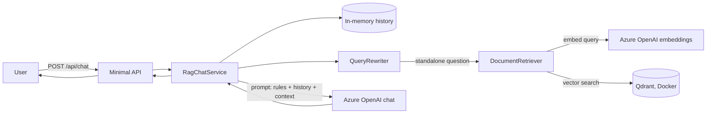

# VeriPark RAG Chatbot — Copilot Studio Licensing Guide

A multi-turn chatbot, written in **C# / .NET 8**, that answers questions about the *Microsoft Copilot Studio Licensing Guide* (PDF) using **Retrieval-Augmented Generation (RAG)**.

| Piece | Technology |
|---|---|
| Web API | ASP.NET Core Minimal API (served on `http://localhost:5080`) |
| Orchestration | Microsoft **Semantic Kernel** (chat completion + embedding abstractions, `ChatHistory`) |
| Chat model + embeddings | **Azure OpenAI** (your own resource — the only cloud dependency) |
| Vector database | **Qdrant**, running locally in Docker |
| PDF reading | PdfPig (pure .NET) |
| Conversation memory | In memory, per conversation id |
| Tests | xUnit |

---

## How it works (in plain language)

**Once, at start-up (ingestion):**

1. The PDF is read page by page and the text is extracted in code.
2. Repeating page footers are removed.
3. Each page is cut into chunks of about 1,200 characters.
4. Every chunk is turned into a vector (a list of 1,536 numbers) by the Azure OpenAI embedding model.
5. The chunks and vectors are stored in a Qdrant collection.

**For every question (chat):**

1. The conversation history is loaded from memory.
2. If this is a follow-up ("compare that with…"), the chat model first rewrites it into a standalone question, so the vector search knows what "that" means.
3. The standalone question is embedded and Qdrant returns the 8 closest chunks.
4. A prompt is built: strict rules + earlier turns + the retrieved passages + the question.
5. The Azure OpenAI chat model answers using only those passages and cites pages like `[p.11]`.
6. The question and answer are saved in the conversation history.



---

## Prerequisites

| Tool | Check with | Where to get it |
|---|---|---|
| .NET SDK 8 or newer | `dotnet --version` | https://dotnet.microsoft.com/download |
| Docker Desktop (or Docker Engine) | `docker --version` | https://www.docker.com/products/docker-desktop |
| An Azure OpenAI resource with two deployments | — | Azure portal (next section) |

---

## Step-by-step setup

### Create the Azure OpenAI resource and deployments

1. In the Azure portal create an **Azure OpenAI** resource.
2. Open **Azure AI Foundry / Azure OpenAI Studio → Deployments** and create two deployments:
   - a **chat model**, for example `gpt-4o` or `gpt-4.1` (note the *deployment name*),
   - an **embedding model**: `text-embedding-3-small` (1,536 dimensions — what this project expects).
3. From **Keys and Endpoint** copy the endpoint (`https://<name>.openai.azure.com/`) and one key.

> Using `text-embedding-3-large` instead? Change `DocumentChunk.EmbeddingDimensions` to `3072`. The app stops with a clear message if the sizes do not match.

### Start Qdrant (local vector database)

From the repository root:

```bash
docker compose up -d
```

Check it:

- Dashboard: http://localhost:6333/dashboard
- Port **6333** is REST, port **6334** is gRPC (the .NET client uses 6334).
- Data is kept in the Docker volume `qdrant_storage`, so it survives restarts.

Without compose, the equivalent command is:

```bash
docker run -d --name veripark-qdrant -p 6333:6333 -p 6334:6334 -v qdrant_storage:/qdrant/storage qdrant/qdrant
```

### Configure Azure OpenAI (no secrets in the repo)

`appsettings.json` contains **empty** values for the endpoint and key on purpose. Provide them with **user-secrets** (recommended for development):

```bash
cd src/VeriPark.RagChatbot.Api
dotnet user-secrets set "AzureOpenAI:Endpoint" "https://<your-resource>.openai.azure.com/"
dotnet user-secrets set "AzureOpenAI:ApiKey" "<your-key>"
dotnet user-secrets set "AzureOpenAI:ChatDeployment" "<your-chat-deployment-name>"
dotnet user-secrets set "AzureOpenAI:EmbeddingDeployment" "<your-embedding-deployment-name>"
cd ../..
```

Or use environment variables (double underscore = nested setting):

```powershell
# PowerShell
$env:AzureOpenAI__Endpoint = "https://<your-resource>.openai.azure.com/"
$env:AzureOpenAI__ApiKey = "<your-key>"
$env:AzureOpenAI__ChatDeployment = "<chat-deployment>"
$env:AzureOpenAI__EmbeddingDeployment = "<embedding-deployment>"
```

```bash
# bash / zsh
export AzureOpenAI__Endpoint="https://<your-resource>.openai.azure.com/"
export AzureOpenAI__ApiKey="<your-key>"
export AzureOpenAI__ChatDeployment="<chat-deployment>"
export AzureOpenAI__EmbeddingDeployment="<embedding-deployment>"
```

If something is missing, the app refuses to start and tells you exactly which setting is empty.

### Run the application

```bash
dotnet restore
dotnet build
dotnet run --project src/VeriPark.RagChatbot.Api
```

On the first start the app loads the PDF into Qdrant in the background (about 43 chunks, a few seconds). Watch the console for `Ingestion finished`. Later starts detect that Qdrant is already up to date and skip the embedding step.

Open **http://localhost:5080** for the chat page, or use the API directly:

```bash
curl http://localhost:5080/health

curl -X POST http://localhost:5080/api/chat -H "Content-Type: application/json" \
     -d '{"message":"What is a Copilot Credit?"}'
```

Reuse the returned `conversationId` for follow-up questions:

```bash
curl -X POST http://localhost:5080/api/chat -H "Content-Type: application/json" \
     -d '{"conversationId":"<id from previous answer>","message":"How much does it cost per credit with pay-as-you-go?"}'
```

### Run the tests

```bash
dotnet test
```

---

## Design decisions

### Chunking strategy (and why)

PdfPig extracts words with positions. The code rebuilds visual **lines** and **paragraphs**, drops lines that repeat on many pages (the footer `Licensing Guide | July 2026 Page | N`), and then applies a **recursive, page-aware splitter**:

- **Chunks never cross a page.** Each chunk has exactly one page number, so citations are precise and checkable.
- **~1,200 characters per chunk (about 300 tokens)** with **200 characters overlap**. That is large enough to keep a price and its explanation together, and small enough that a vector search finds the right passage instead of a whole page.
- **Natural boundaries first.** A page that fits stays whole. Longer pages are split by paragraph, then line, then sentence, then word, and small pieces are merged back up to the limit.
- **Overlap** keeps an idea that falls on a boundary readable in both neighbouring chunks.
- **Contextual header on the embedded text.** What is embedded is `"<document title> - page N" + chunk text`. The stored text stays clean.

Result for this PDF: 19 pages → about 43 chunks. I chose this over fixed-size splitting (cuts sentences and table rows in the middle) and over whole-page chunks (too broad; each page mixes several topics).

### Retrieval

Cosine similarity, top **8** chunks, minimum score **0.2**. Eight is generous on purpose because several questions have multiple parts (for example "price **and** when the guide recommends pay-as-you-go"). All numbers are configurable in `appsettings.json` → `Rag`.

### Multi-turn memory

- History is kept **in memory** per `conversationId` (thread-safe, one request at a time per conversation, idle conversations expire after 120 minutes).
- Follow-ups are handled with a **query-rewrite step**. Example: *"Based on your answer to Question 5, compare it with the credit pack model"* becomes a standalone question mentioning the pay-as-you-go meter and credit packs, so retrieval finds the right pages.
- The last 20 question/answer pairs are replayed to the chat model. Retrieved passages of old turns are **not** replayed, which keeps prompts small.
- Questions about the conversation itself ("What was the first question I asked?") are answered from the history, not from the document.

### Grounding and citations

- The system prompt allows answers **only** from the numbered context passages, and requires the fixed sentence *"I couldn't find that in the Copilot Studio Licensing Guide."* when the answer is not there.
- The model must cite pages as `[p.N]`. The code then **verifies** each cited page against the chunks that were really retrieved; invented pages are dropped. The response contains the cited passages with a snippet and score.
- Temperature defaults to 0.1 for factual, repeatable answers.

### Configuration and secrets

- Strongly typed options (`AzureOpenAIOptions`, `QdrantOptions`, `RagOptions`) with data-annotation validation and `ValidateOnStart`.
- Nothing secret is committed. Secrets come from user-secrets or environment variables.

### Why Qdrant access is behind an interface

`IDocumentChunkRepository` hides the vector store. Only `QdrantDocumentChunkRepository` uses the Semantic Kernel vector-store API, which makes the rest of the code easy to unit test and keeps any future package change in one file.

---

## Troubleshooting

| Symptom | Likely cause and fix |
|---|---|
| App stops at start-up with *"Azure OpenAI configuration is incomplete"* | A setting from Step 3 is empty. |
| `/health` shows `Failed` and the log mentions connection refused | Qdrant is not running. Run `docker compose up -d`, then `POST /api/ingest`. |
| `503` from `/api/chat` | Ingestion has not finished or failed — check `/health`. |
| Azure error `400` mentioning *temperature* | Your chat deployment is a reasoning model that accepts only its default temperature. Remove `Rag:ChatTemperature` (set it to `null`). |
| Error about embedding **dimensions** | Your embedding deployment does not return 1,536 values. Change `DocumentChunk.EmbeddingDimensions`, then `POST /api/ingest?force=true`. |
| Azure `401` / `404` | Wrong key, endpoint, or *deployment name* (it is the name you gave the deployment, not the model name). |
| Compile error in `QdrantDocumentChunkRepository.cs` after a package update | The Semantic Kernel vector-store connector is still evolving and its method names have changed between releases. This is the only file that uses that API; adjust the few calls there. After a successful build, pin package versions with `dotnet list package` and edit `Version="..."` in the csproj. |

---

## Known limitations and next steps

- Conversation memory is lost on restart (as required: "in memory"). A distributed cache would be the production choice.
- PDF tables (such as the summary table on page 5) are flattened to text. A layout-aware or vision-based extractor would improve table questions.
- Retrieval is vector-only. Adding keyword (hybrid) search and a re-ranking step would improve exact-term lookups such as SKU names.
- Streaming responses (server-sent events), per-user authentication and rate limiting are not included.
- For production, prefer Microsoft Entra ID (managed identity) over API keys for Azure OpenAI.

---
# VeriPark.RagChatbot

# VeriPark.RagChatbot
